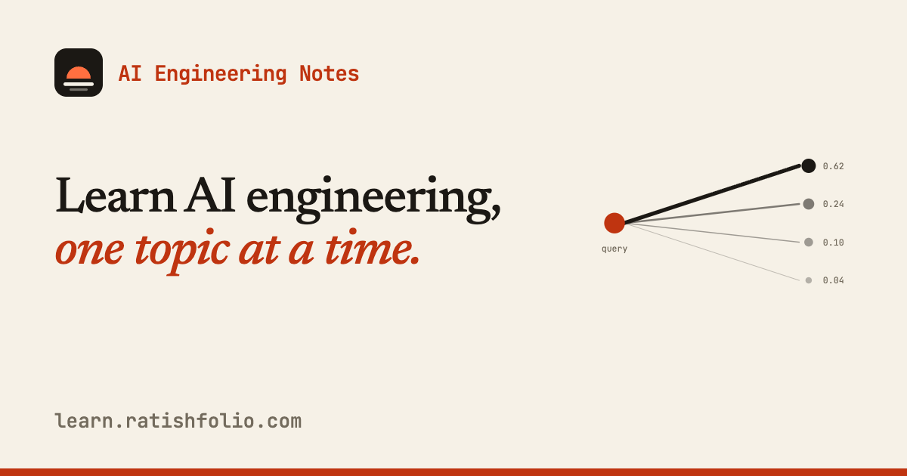

# AI Engineering Notes

**Learning AI engineering in public, one topic at a time.**

I write up one AI engineering topic at a time: what I understood and the resources I used. No fixed syllabus. The next topic is whatever is worth understanding next.

**Live site: https://learn.ratishfolio.com**

## Topics

### Large Language Models

| # | Topic | Notes |
| - | ----- | ----- |
| 01 | [Attention](https://learn.ratishfolio.com/llms/attention/) | Q, K, V, softmax, self vs cross attention, causal and multi-head attention, engineering trade-offs |
| 02 | [KV Cache](https://learn.ratishfolio.com/llms/kv-cache/) | Reusing Keys and Values to speed up inference, the GPU memory it costs, PagedAttention, GQA and MQA |
| 03 | [Speculative Decoding](https://learn.ratishfolio.com/llms/speculative-decoding/) | A draft model proposes tokens, the target model verifies them in one pass, acceptance rate and when it pays off |
| 04 | [Quantization](https://learn.ratishfolio.com/llms/quantization/) | Storing weights in fewer bits, scale and zero point, PTQ vs QAT, GPTQ, AWQ and SmoothQuant, and the effect on inference and the KV cache |
| 05 | [Fine Tuning](https://learn.ratishfolio.com/llms/fine-tuning/) | Updating a pretrained model's weights on a task dataset, full fine-tuning vs PEFT vs SFT, LoRA and QLoRA, and when to pick fine-tuning over prompting or RAG |
| 06 | [Mixture of Experts](https://learn.ratishfolio.com/llms/mixture-of-experts/) | Routing tokens to a subset of experts per layer, top-k routing, active vs total parameters, load balancing and the serving complexity it adds |
| 07 | [Agent Loop](https://learn.ratishfolio.com/agents/agent-loop/) | The loop that sends context to a model, executes the tool it requests, and feeds the result back until the model returns a final answer |

### Agents

| # | Topic | Notes |
| - | ----- | ----- |
| 07 | [Agent Loop](https://learn.ratishfolio.com/agents/agent-loop/) | The loop that sends context to a model, executes the tool it requests, and feeds the result back until the model returns a final answer |
| 08 | [Tool Calling](https://learn.ratishfolio.com/agents/tool-calling/) | How a model requests a function and your application executes it, tool definitions, mapping names to functions, multiple tool calls and the failure cases to handle |
| 09 | [Context Engineering](https://learn.ratishfolio.com/agents/context-engineering/) | What goes into the context, why not to send everything, building a context builder, summarization, retrieval and structured state, and common mistakes |
| 10 | [Agent Memory](https://learn.ratishfolio.com/agents/agent-memory/) | Why agents need memory, context vs memory, short-term, long-term, episodic and semantic memory, and the extract, store, retrieve, update and forget lifecycle |

## Feedback

Spotted a mistake or have a resource that should be linked? Open an issue or reach out on [X (@ratishtwts)](https://x.com/ratishtwts).

## License

Code is [MIT](LICENSE) licensed. The written notes in `src/content/docs` are shared under [CC BY 4.0](https://creativecommons.org/licenses/by/4.0/): reuse them with attribution.
