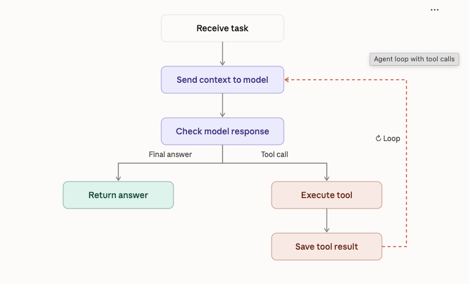

## What is an AI agent?

An AI agent is a software system that uses a model to complete a task.

The agent can:

- Receive a task.
- Send information to a model.
- Select an action.
- Use a tool.
- Read the result.
- Continue until it completes the task.

A normal LLM call returns a response.

An agent can use the response to select its next action.

For example, a user asks:

Find the latest version of Python and explain its main features.

The agent can search for the latest version. It can read the search result. It can then prepare an answer.

The agent does not need to complete the full task in one model call.

## What is the agent loop?

The agent loop is the process that controls an agent.

The loop repeats these steps:

1. Send the current context to the model.
2. Receive the model response.
3. Check the response.
4. Execute a tool if the model requests one.
5. Add the tool result to the context.
6. Repeat until the model returns a final answer.

The loop must have a stop condition. Without a stop condition, the agent can continue indefinitely.

**The execution flow**

## Main components

An agent loop needs these components.

**Model**

The model processes the current context. It returns a final answer or requests a tool.

**Context**

The context contains the information that the model needs. It can contain the user task, previous messages, and tool results.

**Tools**

Tools allow the agent to perform actions. For example, a tool can search the web, read a file, or run a calculation.

**Executor**

The executor runs the requested tool. It then returns the result to the agent loop.

**Stop condition**

The stop condition tells the agent when to stop. For example, the agent can stop when the model returns a final answer or when it reaches the maximum number of steps.

## Why does the loop matter?

The model does not execute external actions by itself.

The application must receive the model's tool request. It must validate the request. It must execute the tool and return the result.

The model can then use that result to decide what to do next.

This process connects model reasoning with software execution.

## Build the first agent

For this exercise, use a mock model. The mock model will return predefined responses. This lets you test the loop without an API key.

https://github.com/ratishjain12/ai-engineering-notes/tree/main/examples/agents/agent-loop

This is a teaching example. It uses a mock model and one predefined tool call. It does not yet use a real LLM API.

## What happens in this example?

1. The loop sends the task to the mock model.
2. The mock model requests the calculator tool.
3. The application executes the calculator.
4. The application adds the result to the context.
5. The loop calls the model again.
6. The model returns the final answer.
7. The loop stops and returns the answer.

The `max_steps` value limits the number of model calls.

The tool name check prevents this example from executing an unknown tool.

A production agent needs more controls. It must validate tool arguments, handle tool errors, and limit execution time.

## Key points

- An agent uses a model to select its next action.
- The agent loop controls model calls and tool execution.
- Tools allow an agent to interact with external systems.
- Tool results become part of the context.
- A stop condition limits execution.
- A basic agent loop does not require a large framework.

## Exercise

Extend the example.

1. Add a second tool named `multiply`.
2. Allow the agent to call either tool.
3. Return an error when the model requests an unknown tool.
4. Test what happens when the model never returns a final answer.
