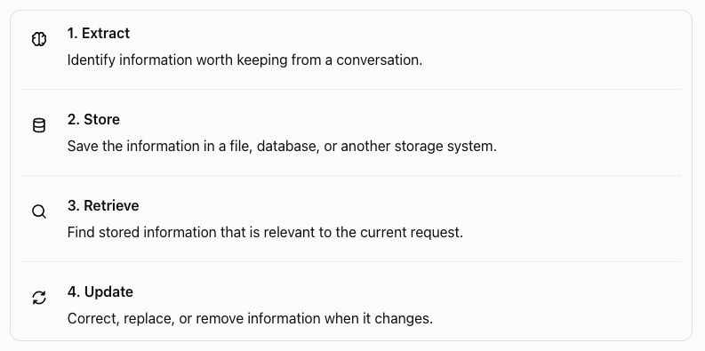
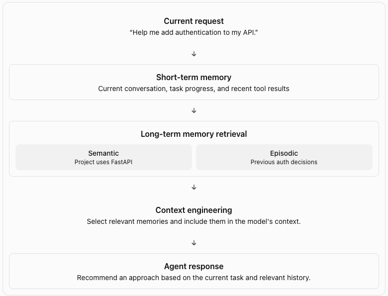

An AI agent receives information from the current conversation. It uses this information to decide what to do next.

But the information may not be available in a later conversation.

Agent memory allows an agent to store information and use it in the future.

For example, a user tells an agent:

> I prefer Python. I use PostgreSQL for my projects.
> 

The agent stores these preferences.

A few days later, the user asks:

> Recommend a backend stack for my next project.
> 

The agent retrieves the stored preferences and uses them to make a recommendation.

Without memory, the agent may ask the same questions again.

With memory, the agent can use information from earlier interactions.

## Why Do Agents Need Memory?

Memory helps an agent in three main ways.

- Remember facts: Store user preferences, project details, and important decisions.
- Continue tasks: Resume work without starting from the beginning.
- Improve decisions: Use relevant information from past interactions.

Consider a coding agent that helps a developer build an application.

During one session, the developer specifies the database, API framework, and coding conventions. In a later session, the agent can retrieve these details instead of asking for them again.

Memory is useful when information from the past can improve a decision in the present.

## Context vs. Memory

Context and memory are related, but they serve different purposes.

| Context | Memory |
| --- | --- |
| Information available to the model now | Information stored for future use |
| Used to answer the current request | Used across requests or sessions |
| Includes instructions, messages, and retrieved data | Includes saved facts, preferences, and past events |
| Usually assembled for each model call | Stored and retrieved when needed |

Memory does not automatically become context.

The agent must retrieve relevant memories and include them in the context sent to the model.

For example:

1. The agent stores that the user prefers Python.
2. The user starts a new conversation.
3. The agent retrieves the Python preference.
4. The agent adds it to the current context.
5. The model uses it to answer the request.

This connects directly to the previous topic, [Context Engineering](/agents/context-engineering/).

Memory does not automatically become context.

The agent must retrieve relevant memories and include them in the context sent to the model.

## How Does Agent Memory Work?



## What Should an Agent Remember?

An agent should not store every message. It should select information that may be useful later.

Examples include:

- User preferences, such as a preferred programming language.
- Project facts, such as the database used by an application.
- Decisions, such as why a particular architecture was selected.
- Past events, such as the steps completed during a task.
- Instructions that apply to future interactions.

The agent should also avoid storing information that is irrelevant, unreliable, or no longer valid.

## Types of Memory

### Short-Term Memory

Short-term memory contains information needed during the current conversation or task.

For example, a user asks an agent to build a REST API. During the conversation, the user specifies the framework, database, and authentication requirements.

The agent uses these details to complete the task.

Short-term memory often includes:

- Recent conversation messages.
- The current task and its status.
- Tool calls and their results.
- Temporary decisions made during execution.

example:

```jsx
conversation = [
    {"role": "user", "content": "Build a REST API."},
    {"role": "user", "content": "Use FastAPI and PostgreSQL."},
]
```

**Important**: Short-term memory does not necessarily mean that the information is stored only in RAM. A system can persist conversation history in a database and still treat it as short-term memory.

### Long-Term Memory

Long-term memory preserves information across conversations or task sessions.

For example, a user repeatedly works on Python backend projects and prefers PostgreSQL.

An agent can save these preferences and retrieve them during a later session.

Long-term memory may contain:

- User preferences.
- Project requirements.
- Important decisions.
- Facts learned from previous interactions.
- Results of completed tasks.

A simple implementation can store information in a JSON file.

```jsx
{
  "preferred_language": "Python",
  "preferred_database": "PostgreSQL"
}
```

Long-term memory requires more than storage. The system must also decide what to save, when to retrieve it, and when to update or delete it.

## Episodic Memory

Episodic memory stores information about specific events or experiences.

It answers questions such as:

- What happened?
- What did the agent do?
- What was the outcome?

An episodic memory might look like this:

```jsx
{
  "event": "Resolved database connection failures",
  "cause": "Connection pool exhaustion",
  "action": "Increased the connection pool size",
  "outcome": "Service recovered"
}
```

## Semantic Memory

Semantic memory stores facts and knowledge without requiring the full event in which they were learned.

For example, an agent knows that a project uses FastAPI and PostgreSQL.

It can retrieve these facts without loading the conversation in which the user mentioned them.

A semantic memory might look like this:

```jsx
{
  "project": "Inventory API",
  "framework": "FastAPI",
  "database": "PostgreSQL"
}
```

Semantic memory is useful for retrieving stable facts, preferences, and project information.

## Episodic vs. Semantic Memory

Consider an agent that helps a developer debug a database issue.

Episodic
A specific experience

“Yesterday, the API failed because the database connection pool was exhausted. Increasing its size resolved the issue.”

Semantic
A stored fact

“The Inventory API uses PostgreSQL.”

The difference is the information being preserved.

- Episodic memory preserves an event and its outcome.
- Semantic memory preserves a fact or piece of knowledge.

An agent can use both. It can retrieve the project's database configuration and past debugging events before deciding how to investigate a new failure.

## How These Types Work Together



Notice that memory retrieval and context engineering are separate steps. Memory provides stored information. Context engineering selects and organizes the information the model needs now.

## The Memory Lifecycle

Agent memory is not only about storing information. The agent must decide what to remember, how to store it, and when to use or remove it.

A memory system has five main operations:

1. Extract
2. Store
3. Retrieve
4. Update
5. Forget

These operations form the memory lifecycle.

### Extract

The agent identifies information that may be useful in future interactions.

A conversation can contain facts, preferences, temporary requests, and irrelevant details. The agent should not save every message as a memory.

For example, a user says:

> I use Python for backend projects. I prefer PostgreSQL for relational data.
> 

The system can extract two memories:

- Preferred programming language: Python.
- Preferred relational database: PostgreSQL.

The system can use rules, an LLM, or a combination of both to identify useful information.

The extraction process should preserve the meaning of the original information. It should not turn an uncertain statement into a confirmed fact.

### Store

The system saves extracted information so it can be used later.

The storage method depends on the application.

Examples include:

- JSON files for simple experiments.
- Relational databases for structured records.
- Vector databases for similarity-based retrieval.
- Dedicated memory systems, such as Mem0, for memory extraction and management.

A stored memory should contain enough information to support future use.

### Retrieve

The system searches for memories that are relevant to the current task.

For example, the user asks:

> Recommend a database for my next backend project.
> 

The system may retrieve the stored preference for PostgreSQL.

It then adds the retrieved memory to the context sent to the LLM.

The model can use this information to make a recommendation.

There are several retrieval methods:

- Exact lookup: Find a memory by its key or identifier.
- Keyword search: Match words in the query with stored information.
- Semantic search: Find information based on meaning, often with embeddings.
- Hybrid search: Combine keyword and semantic search.

The system should retrieve relevant memories, not every memory it has stored.

### Update

Memories can become incorrect or outdated.

The system must update them when new information changes an existing fact.

For example, the user first says:

> I prefer PostgreSQL.
> 

Later, the user says:

> For my new project, I will use MySQL instead.
> 

The system must determine whether the new statement replaces a general preference or applies only to the new project.

These statements are not necessarily contradictory. One describes a general preference. The other describes a specific project decision.

A memory system should preserve this distinction.

Possible update strategies include:

- Replace an existing value.
- Add a new fact with a narrower scope.
- Mark an old fact as outdated.
- Keep conflicting facts until the system can resolve them.

### Forget

Some memories must be removed.

For example, a user may ask an agent to forget a saved preference. A project may also end, making some temporary information unnecessary.

A memory system should support deletion and apply it to the relevant records.

Forgetting is not the same as updating. Updating changes information that should remain available. Forgetting removes information that should no longer be retained.

If the system stores copies of a memory in multiple locations, it must also consider those copies and any indexes used for retrieval.

## Hands-on Exercise

https://github.com/ratishjain12/ai-engineering-notes/tree/main/examples/agents/agent-memory

The example will demonstrate how to:

1. Save facts from a conversation.
2. Retrieve relevant memories in a later session.
3. Update a stored preference.
4. Include retrieved memories in an LLM prompt.

The goal is to understand how a memory layer works with an agent, not only how to call an SDK method.