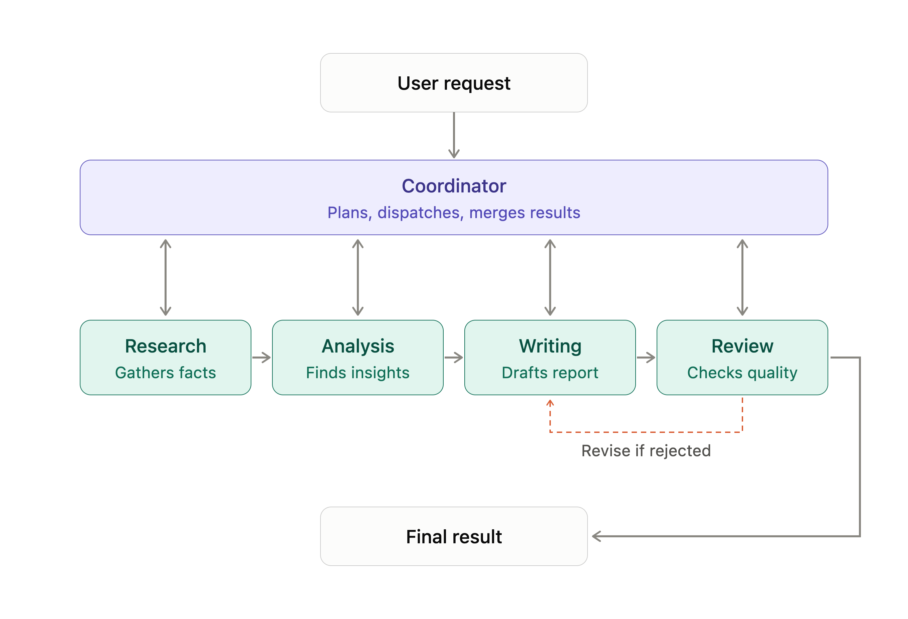

An AI agent can perform a task by itself.

But some tasks need multiple steps. Other tasks need different types of work, such as research, analysis, and writing.

We can use agent workflows to manage these tasks.

## What is an agent workflow?

An agent workflow is a sequence of steps that an application uses to complete a task.

Each step has a defined responsibility.

For example, consider a research task:

1. Search for information.
2. Analyse the information.
3. Write a report.
4. Review the report.

The application controls the order of execution.

An agent can perform one or more of these steps.

## Types of agent workflows

### 1. Sequential workflow

Tasks run one after another.

A task starts after the previous task completes.

```text
Research → Analysis → Writing
```

### 2. Parallel workflow

Independent tasks run at the same time.

```text
          ┌── Research security ──┐
User task ├── Research pricing  ──┼── Combine results
          └── Research features  ─┘
```

### 3. Conditional Workflow

The next task depends on the result of the current task.

```text
       Analyse report
             |
       Is report valid?
          /     \
        Yes      No
         |        |
       Publish  Revise
```

Use this pattern when the workflow must make decisions.

### 4. Iterative workflow

A task repeats until it meets a condition.

```text
Generate report
      |
   Evaluate
      |
  Is it good?
    /    \
  Yes     No
   |       |
 Finish  Improve
           |
       Evaluate again
```

Use this pattern when an output needs multiple rounds of improvement.

## What is a multi-agent system?

A multi-agent system uses multiple agents to complete a task.

Each agent has a specific responsibility.

For example, a research system can have:

| Agent | Responsibility |
| --- | --- |
| Researcher | Collect information |
| Analyst | Evaluate information |
| Writer | Prepare the report |
| Reviewer | Check the report |

A coordinator manages the agents and their tasks.

Important: A workflow does not always need multiple agents. A single agent, multiple tools, and normal Python functions can also complete a workflow.

Use multiple agents when separate responsibilities require different instructions, context, or decision-making.

## Workflow vs Multi-agent system

| **Agent workflow** | **Multi-agent system** |
| --- | --- |
| Defines how tasks run | Uses multiple agents |
| Can use one agent | Uses two or more agents |
| Can use Python functions and tools | Agents can have separate tools and instructions |
| Controls task execution | Coordinates agent execution |

A multi-agent system can use an agent workflow to coordinate its agents.

## How do agents work together?

A multi-agent system needs a way to coordinate its agents.

A common design uses a coordinator.

The coordinator:

- Receives the user's request.
- Selects the agents required.
- Assigns tasks.
- Passes information between agents.
- Collects their results.
- Produces the final response.



## When should you use multiple agents?

Use multiple agents when:

- Tasks require different responsibilities.
- Agents need different tools or instructions.
- Work can be divided into independent parts.
- Separate agents can improve the quality of the result.

## Does every agent need its own LLM?

No.

A multi-agent system can use:

- The same model for all agents.
- Different models for different agents.
- Different instructions and tools for each agent.

## Agent Communication and Coordination

A multi-agent system uses multiple agents to complete a task.

But creating multiple agents is not enough.

They must communicate and coordinate their work.

Agent communication defines how agents exchange information.

Agent coordination defines how agents organise and execute their tasks.

## 1. Why do agents need to communicate?

Consider a research system with three agents:

- Research Agent collects information.
- Analysis Agent evaluates the information.
- Writing Agent prepares a report.

The Analysis Agent needs the Research Agent's findings.

The Writing Agent needs the Analysis Agent's output.

Agents must exchange information to complete the task.

Without communication, each agent works in isolation.

## 2. How do agents communicate?

There are several ways to exchange information.

### Direct communication

One agent sends a message or task to another agent.

```text
Research Agent
      |
      | Sends research findings
      v
Analysis Agent
```

### Shared state

Agents read and write information to a shared state.

```python
state = {
    "topic": "AI agent frameworks",
    "research": None,
    "analysis": None,
    "report": None
}
```

The Research Agent updates `research`.

The Analysis Agent reads `research` and updates `analysis`.

The Writing Agent reads `analysis` and creates the report.

All agents use the same state.

### Message-based communication

Agents exchange structured messages through a communication channel.

```python
message = {
    "sender": "research_agent",
    "receiver": "analysis_agent",
    "task": "analyse_research",
    "content": {
        "findings": [
            "Framework A supports tool calling",
            "Framework B supports multi-agent workflows"
        ]
    }
}
```

The receiving agent processes the message.

This approach is useful when agents operate independently or run on different services.

## What is agent coordination?

Communication moves information between agents.

Coordination manages what agents should do and when they should do it.

Consider this workflow:

1. Coordinator receives a research request.
2. Coordinator assigns work to the Research Agent.
3. Research Agent completes its task.
4. Coordinator sends the findings to the Analysis Agent.
5. Analysis Agent completes its task.
6. Coordinator sends the analysis to the Writing Agent.
7. Writing Agent prepares the report.

The coordinator manages the execution process.

### Common coordination patterns

**Centralized coordination**

A central coordinator manages all agents.

```text
          Coordinator
          /    |    \
         v     v     v
      Agent A Agent B Agent C
```

The coordinator assigns tasks and collects results.

Advantages:

- Clear execution control.
- Easier to manage shared state.
- Easier to track failures.

Limitation:

- The coordinator can become a bottleneck.

### Decentralized coordination

Agents communicate and coordinate directly.

```text
Agent A <----> Agent B
   ^               |
   |               v
Agent C <----------+
```

There is no single coordinator for every decision.

Advantages:

- Agents can make local decisions.
- Less dependence on one central component.

Limitations:

- Harder to manage communication.
- Harder to prevent conflicting actions.
- More complex to debug.

## What happens when agents disagree?

Agents can produce conflicting results.

For example:

- Research Agent recommends Framework A.
- Analysis Agent recommends Framework B.

The system needs a way to resolve this conflict.

Common approaches include:

1. **Coordinator decision**: The coordinator evaluates both results and selects one.
2. **Reviewer agent**: A separate agent checks the conflicting results.
3. **Rule-based decision**: The application uses predefined rules to select the result.
4. **[Human review](/agents/human-in-the-loop/)**: A human makes the final decision.

Do not assume that one agent is always correct.

## Important design considerations

| Concern | What to manage |
| --- | --- |
| Message format | Define a consistent message structure |
| Shared state | Control how agents access and update data |
| Task ownership | Define which agent handles each task |
| Failure handling | Handle failed or unresponsive agents |
| Conflicts | Resolve conflicting outputs |
| Execution limits | Prevent endless communication loops |

## How do we implement orchestration?

There are two common approaches.

**Custom orchestration**

You write the execution logic yourself using Python.

```python
research = research_agent(topic)

analysis = analysis_agent(research)

report = writing_agent(analysis)

review = review_agent(report)
```

**Orchestration frameworks**

You use a framework to manage complex workflows.

Some examples:

- LangGraph: Manages state, nodes, edges, and conditional execution.
- CrewAI: Provides agents, tasks, and crews.
- Microsoft Agent Framework: Provides agent and workflow capabilities.

These frameworks provide abstractions for execution, state, and coordination.

You do not need a framework for every workflow.

## Orchestration vs Communication

| Communication | Orchestration |
| --- | --- |
| Exchanges information between agents | Manages agent execution |
| Defines how messages are sent | Defines when tasks run |
| Uses HTTP, A2A, queues, etc. | Uses workflows, state, and execution logic |
| Connects agents | Coordinates agents |

Communication helps agents exchange information.

Orchestration manages how they work together.

## Hands-on Exercise

In this exercise, you will build a multi-agent research pipeline with [LangGraph](https://www.langchain.com/langgraph): three researchers, an analyst, a writer and a reviewer that coordinate through one shared state.

https://github.com/ratishjain12/ai-engineering-notes/tree/main/examples/agents/agent-workflows-and-multi-agent-systems

The example demonstrates:

1. Shared state: a typed `State` that every agent reads from and writes to, with a reducer so parallel researchers append to `research` instead of overwriting it.
2. A parallel workflow: one researcher per framework runs at the same time, and the analyst starts only after all of them finish.
3. A sequential workflow: analyst, writer and reviewer run in order, each reading the previous output from the state.
4. An iterative workflow: a conditional edge sends the report back to the writer with the reviewer's feedback until it is approved or the revision limit is reached.

Each agent returns only the state keys it owns. The graph, not a model, decides who runs next and when to stop.
