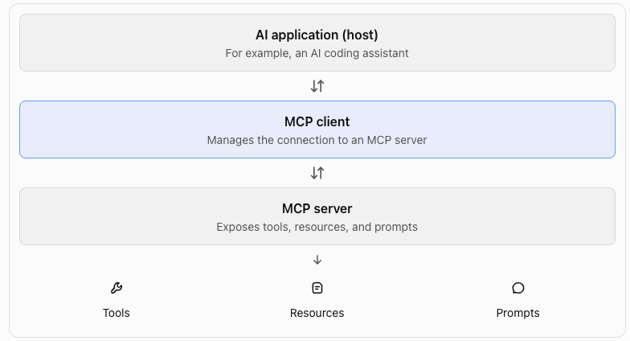
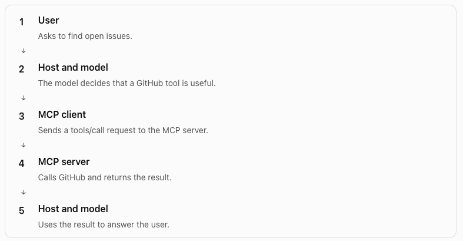

## The problem MCP solves

Imagine you are building an AI agent. It needs to work with GitHub, Slack, and a database.

Without MCP, you can write separate integrations for each service. Each integration needs its own tool definitions, authentication, and execution logic.

Now imagine another AI application needs the same services. You may need to build or adapt those integrations again.

MCP provides a standard protocol for connecting AI applications to external tools and context.

## What is MCP?

MCP stands for Model Context Protocol.

An MCP server can expose three main capabilities:

- Tools: actions the application can request, such as creating an issue.
- Resources: data the application can read, such as a document or database schema.
- Prompts: reusable prompt templates that an application can retrieve.

MCP does not replace the LLM, and it does not make a model inherently smarter. It standardizes how applications connect to external capabilities.

## How MCP works



For example, your coding assistant can connect to a GitHub MCP server and discover a tool named `create_issue`.

When you ask it to create an issue, the application can use the model to decide when to call that tool. The MCP client sends the request to the server, and the server executes the operation and returns a result.

The model does not directly communicate with the MCP server. The AI application manages that interaction.

## The key distinction

| [Function calling](/agents/tool-calling/) | MCP |
| --- | --- |
| Defines how a model requests a function call | Defines how an application communicates with external capabilities |
| Uses tool schemas provided to the model | Provides a standard way to discover and call server capabilities |
| Your application executes the function | An MCP server handles the requested operation |

## When should you use MCP?

Use MCP when you want multiple compatible AI applications to access a service through a shared interface.

For example, instead of building separate GitHub integrations for your coding assistant, another desktop AI client, and an internal agent, you can expose a GitHub MCP server that each compatible client can connect to.

MCP does not remove all integration work. You still need to build or configure the server, handle authentication and permissions, and manage failures.

## MCP architecture: Host, Client, and Server

### The three components

**Host**

The AI application that the user interacts with. It manages the conversation, the model, and MCP connections.

Example: a coding assistant.

**Client**

The component inside the host that manages a connection to an MCP server. A host can have multiple MCP clients.

Each client manages its own server connection.

**Server**

The component that exposes capabilities through MCP. It can provide tools, resources, and prompts.

Example: a GitHub MCP server that provides repository and issue tools.

### How a tool call works

Suppose you ask your coding assistant:

> Find the open issues in my GitHub repository.




The model does not send MCP protocol messages directly. The host uses the MCP client to communicate with the server.

### How the client discovers tools

The client does not need to know every tool in advance.

During the MCP initialization and discovery process, the client can request the server's available tools using the `tools/list` method.

A server might return a tool definition like this:

```json
{
  "name": "list_issues",
  "description": "List issues in a repository",
  "inputSchema": {
    "type": "object",
    "properties": {
      "owner": {"type": "string"},
      "repo": {"type": "string"}
    },
    "required": ["owner", "repo"]
  }
}
```

The host can make this tool available to the model. When the model requests it, the client sends a `tools/call` request with the required arguments.

Notice the distinction:

- `tools/list` discovers available tools.
- `tools/call` requests execution of a tool.

### Local versus remote MCP servers

MCP supports different ways to connect to a server.

| Transport | Typical use |
| --- | --- |
| `stdio` | A local MCP server runs as a subprocess. The client exchanges messages through standard input and output. |
| Streamable HTTP | A client connects to an MCP server over HTTP. This is suitable for remote services. |

### What you should remember

- The host manages the AI experience.
- The client manages the connection.
- The server exposes capabilities.
- `tools/list` discovers tools.
- `tools/call` requests tool execution.
- The server returns the result, and the host decides how to use it.

## Hands-on Exercise

In this exercise, you will build a small MCP server in Python. It will expose a tool that lists issues from a mock issue tracker.

The goal is to understand how an MCP server exposes tools and how an MCP client can discover and call them.

https://github.com/ratishjain12/ai-engineering-notes/tree/main/examples/agents/mcp-example

The example demonstrates:

1. Create an MCP server and register tools with `@mcp.tool()`.
2. Run it over `stdio`.
3. Inspect it with `mcp dev server.py` to see `tools/list` and `tools/call` in action.
4. Connect it to a host such as Claude Code.
