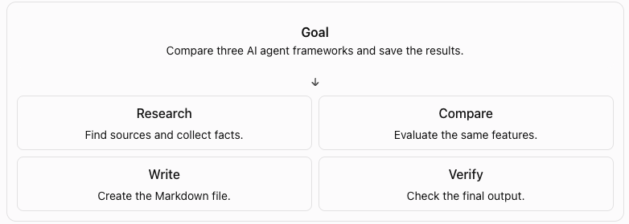
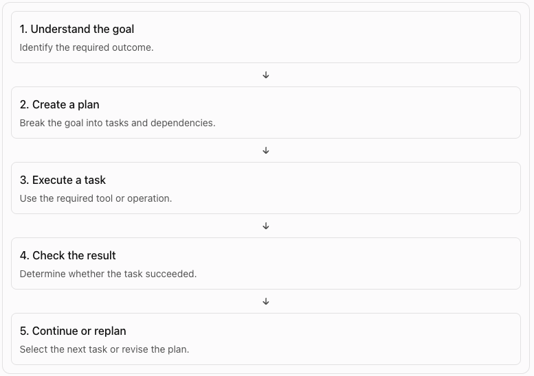

## Why Do Agents Need Planning?

An AI agent can use tools, retrieve information, and respond to user requests. But a complex task often requires more than one action.

Consider this request:

> Research three AI agent frameworks, compare their features, and save the results in a Markdown file.
>

The agent must perform several actions:

1. Identify three frameworks to research.
2. Find reliable sources for each framework.
3. Extract the relevant information.
4. Compare the features.
5. Write the results to a Markdown file.
6. Check that the file contains the required information.

Each action contributes to the final result. The agent must also decide which actions to perform first.

Planning is the process of deciding which actions are needed to achieve a goal and how to perform them.

Task decomposition is one part of planning. It breaks a complex goal into smaller tasks that are easier to execute and verify.

## What Is Task Decomposition?

Task decomposition converts a large task into smaller tasks.

A useful task should have a clear purpose and an observable result.

For example, consider the research request from the previous section.



However, a list of tasks is not yet a complete execution plan. The agent must also know which tasks depend on other tasks and when a task is complete.

## What Makes a Good Plan?

A good plan contains enough information for the agent to execute each task and determine whether it succeeded.

A task can include:

- ID: A unique identifier.
- Description: The action to perform.
- Dependencies: Tasks that must finish first.
- Status: The current execution state.
- Expected result: The output required for success.

```json
{
  "id": "research_frameworks",
  "description": "Collect feature information for three frameworks",
  "depends_on": [],
  "status": "pending",
  "expected_result": "Research notes for three frameworks"
}
```

The agent can use this structure to track progress instead of relying only on conversation history.

A typical task can move through these states:

- `pending`: The task has not started.
- `in_progress`: The task is being executed.
- `completed`: The expected result was produced and checked.
- `failed`: The task could not be completed.
- `blocked`: A required task or resource is unavailable.

The exact states depend on the application. The important point is that the agent must distinguish between a task that has been attempted and a task that has succeeded.

## Planning vs. Execution

Planning and execution are different operations.

Planning decides what needs to happen.

Execution performs the actions and checks their results.

For example, the plan may say:

> Retrieve the official documentation for each framework.
>

Execution calls the search or browser tool to retrieve the documentation. The agent then checks whether the tool returned usable results.

If the tool fails, the agent should not mark the task as completed.



This cycle connects planning to the [agent loop](/agents/agent-loop/) you studied earlier.

## Static Plans vs. Dynamic Plans

An agent does not always need to create a new plan during execution.

There are two common approaches.

### Static Planning

The system creates the plan before execution and follows it.

This works well when the task is predictable and the steps are known.

For example, a deployment workflow may always run tests, build an artifact, and deploy it after approval.

### Dynamic Planning

The agent can change the plan when it receives new information or encounters a failure.

For example, the agent may try to retrieve a documentation page. If the page is unavailable, it can search for another official source and continue.

Dynamic planning is useful for tasks with uncertainty. However, it also introduces risk. The agent may repeatedly change its plan, add unnecessary tasks, or move away from the original goal.

A practical system can combine both approaches: start with a plan, then allow controlled changes when needed.

## Task Dependencies and Execution Order

A plan can contain tasks that depend on other tasks.

An agent must know which tasks it can start and which tasks must wait.

The plan could contain these tasks:

```json
Task 1: Find three frameworks
Task 2: Collect information about each framework
Task 3: Compare the frameworks
Task 4: Write the comparison to a file
Task 5: Verify the file
```

The agent must follow this order:

```json
Find frameworks
      |
      v
Collect information
      |
      v
Compare frameworks
      |
      v
Write the file
      |
      v
Verify the file
```

This is a sequential plan. Each task must finish before the next task can start.

### Represent dependencies

A task can use a `depends_on` field to identify its dependencies.

```json
tasks = [
    {
        "id": "find_frameworks",
        "depends_on": [],
        "status": "pending"
    },
    {
        "id": "collect_information",
        "depends_on": ["find_frameworks"],
        "status": "pending"
    },
    {
        "id": "compare_frameworks",
        "depends_on": ["collect_information"],
        "status": "pending"
    }
]
```

A task is ready when all its dependencies are complete.

### Independent tasks can run in parallel

Not every task needs to wait for another task.

Suppose the agent must collect information about three frameworks:

```json
Find frameworks
      |
      +------> Research Framework A
      |
      +------> Research Framework B
      |
      +------> Research Framework C
                    |
                    v
              Compare results
                    |
                    v
                Write file
```

Use parallel execution only when the tasks are independent and the available resources support it.

### Determine which task can run next

For every task:

1. Read its dependencies.
2. Check the status of each dependency.
3. If all dependencies are complete, mark the task as ready.
4. Otherwise, keep the task waiting.

## What Happens When a Plan Fails?

A plan describes what the agent expects to do. It does not guarantee that every task will succeed.

Suppose the agent must read a documentation page, but the URL returns a 404 error.

The agent has several options:

1. Retry the request if the failure may be temporary.
2. Search for the documentation at another URL.
3. Use another reliable source.
4. Mark the task as failed if it cannot continue.

The correct action depends on the failure.

The agent must not mark the research task as complete merely because it attempted to open the page.

If the agent has no research notes, it cannot produce a reliable comparison. It should not continue as if the research succeeded.

### Replanning

Replanning means changing the current plan when new information makes the existing plan unsuitable.

```json
Original plan:
1. Open documentation URL
2. Extract framework features
3. Compare frameworks
4. Write report

New information:
The documentation URL is unavailable.

Updated plan:
1. Search for the official documentation
2. Extract framework features
3. Compare frameworks
4. Write report
```

The agent does not need to discard the entire plan. It can replace the failed task and preserve the tasks that are still valid.

This makes planning more useful in environments where tool calls, APIs, and external resources can fail.

### When should an agent replan?

Replanning can be useful when:

- A required tool fails.
- A task produces unexpected output.
- A dependency cannot be completed.
- New information changes the next action.
- The current plan no longer meets the user's goal.

However, replanning also has a cost.

An agent can waste time by repeatedly generating new plans without making progress. It can also drift away from the original goal.

## Hands-on Exercise

https://github.com/ratishjain12/ai-engineering-notes/tree/main/examples/agents/agent-planning-and-task-decomposition

The example demonstrates:

1. Break a goal into tasks.
2. Track dependencies and task status.
3. Execute tasks in the correct order.
4. Verify task results before marking them complete.
5. Replan when a task fails.
