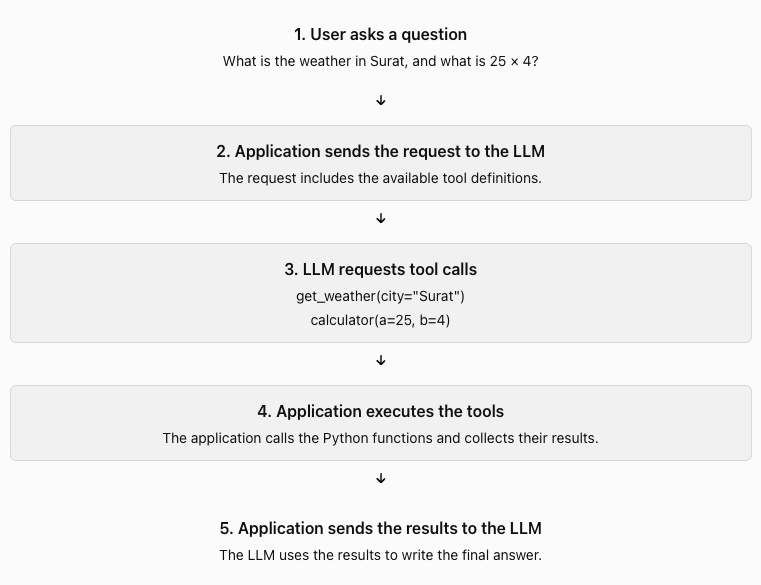

## What is tool calling?

An LLM can understand a question and generate text. But it cannot perform every action by itself.

For example, a user asks:

What is the weather in Surat, and what is 25 × 4?

The LLM may know how to calculate 25 × 4. But it does not know the current weather in Surat unless it has access to weather data.

We can give the LLM access to tools.
A tool is a function that the application can execute.

For this example, we can define two tools:

- `get_weather(city)` gets weather data for a city.
- `calculator(a, b)` calculates the product of two numbers.

## How does tool calling work?



**The LLM requests a tool. Your application executes it.**

The LLM does not automatically run your Python function. Your application must handle the request.

## How does the LLM know which tools are available?

You send tool definitions with the request.

A tool definition usually includes:

- A name.
- A description.
- The input parameters.
- The data types of those parameters.

```python
{
  "name": "calculator",
  "description": "Multiply two numbers",
  "parameters": {
    "a": "number",
    "b": "number"
  }
}
```

This tells the LLM what the tool does and what inputs it needs.

The description matters. It helps the LLM decide when to use the tool.

The schema also helps the API validate the structure of the tool arguments. Your application should still validate inputs before execution.

## What does a tool call look like?

Suppose the LLM decides to use the calculator.

It may return a structured request similar to this:

```python
{
  "name": "calculator",
  "arguments": {
    "a": 25,
    "b": 4
  }
}
```

This is a request to call the tool. It is not the result of the calculation.
Your application then executes the function:

```python
def calculator(a, b):
    return a * b

result = calculator(25, 4)
print(result)
```

The application sends `100` back to the LLM. The LLM can then use that result in its answer.

Actual API responses have provider-specific formats. Your application must read the correct fields from the response.

## How do you connect a tool name to a Python function?

Your application needs a way to find the correct function.

A simple approach is to use a dictionary.

```python
def calculator(a, b):
    return a * b

def get_weather(city):
    weather_data = {
        "Surat": "32°C, sunny"
    }
    return weather_data.get(city, "Weather data unavailable")

TOOLS = {
    "calculator": calculator,
    "get_weather": get_weather
}
```

```python
tool_name = "calculator"
arguments = {"a": 25, "b": 4}

tool = TOOLS.get(tool_name)

if tool is None:
    raise ValueError("Unknown tool")

result = tool(**arguments)
print(result)
```

The expression `tool(**arguments)` passes the dictionary values as named arguments.

**Important**: Do not execute arbitrary code that the LLM generates. Only allow tools that your application explicitly provides.

## Can the LLM call more than one tool?

Yes. Some model APIs support multiple tool calls in one response.

For our example, the LLM may request both:

- `get_weather(city="Surat")`
- `calculator(a=25, b=4)`

Your application can execute both calls and send both results back to the model.

The model can then produce an answer such as:

> The weather in Surat is 32°C and sunny. 25 × 4 = 100.


## What can go wrong?

Tool calling introduces new failure cases.

| **Problem** | **What your application should do** |
| --- | --- |
| Unknown tool name | Reject the request. |
| Missing or invalid arguments | Validate the arguments and return an error. |
| Tool execution fails | Catch the error and report the failure to the model. |
| Tool returns a large result | Limit or summarize the result. |
| Tool performs a sensitive action | Check permissions or ask for approval. |

Treat tool inputs as untrusted data. A tool that sends emails, deletes files, or changes account settings needs stricter controls than a calculator.

## How is this different from the Agent Loop?

These concepts work together, but they solve different problems.

| Agent Loop | Tool Calling |
| --- | --- |
| Controls the execution cycle. | Defines how the model requests functions. |
| Decides when to continue or stop. | Identifies the requested tool and its arguments. |
| Sends results back to the model. | Executes the requested function and returns its result. |

The [Agent Loop](/agents/agent-loop/) is the overall process. Tool calling is one part of that process.

## Your hands-on task

Use a real LLM API for this lesson. Keep the weather function mocked. This lets you focus on tool calling without needing a weather API.

https://github.com/ratishjain12/ai-engineering-notes/tree/main/examples/agents/tool-calling

Build it in this order:

1. Create the OpenAI client and set up logging.
2. Write the calculator function.
3. Write the get_weather function with mock weather data.
4. Define a Pydantic model for each tool's parameters.
5. Register both functions in the TOOLS dictionary.
6. Convert each model into a tool schema with `pydantic_function_tool`.
7. Write a system prompt that tells the model when to use the tools and how to format the answer.
8. Send the user's request, the system prompt and both tool schemas with `client.responses.create`.
9. Collect the `function_call` items from the model's output. The model may return several in one response.
10. Execute each requested tool, log its name, arguments, result and duration, and append a `function_call_output` with its `call_id`.
11. Call the model again with the results; repeat until it returns no tool calls or `max_steps` is reached.
12. Print the final answer.

Success condition: When you ask, “What is the weather in Surat, and what is 25 × 4?”, the model should request the appropriate tools, your application should execute them, and the model should produce a final answer using their results.

Once this works, the next step is to handle invalid arguments, tool failures, and multiple tool calls correctly.
