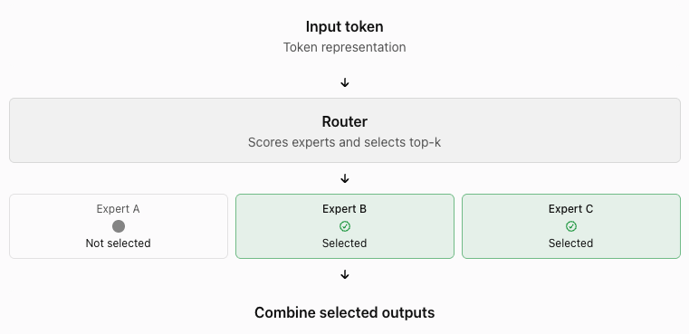

Mixture of Experts (MoE) is a model architecture that uses different neural networks, called experts, to process different types of input.

A normal neural network uses the same set of parameters for every input.

An MoE model can select only some experts for each input.

This allows the model to have many parameters without using all of them for every token.

## Example

Imagine a team of engineers.

- One engineer is good at databases.
- One engineer is good at networking.
- One engineer is good at security.
- One engineer is good at machine learning.

When a problem arrives, a manager sends it to the engineers who can best solve it.

MoE uses a similar idea.

- The experts are neural networks.
- The manager is the router.
- The problem is a token.
- The selected experts process the token.

## Why do we need MoE?

A larger model can learn more patterns. However, a larger dense model also needs more computation for each token.

| Property | Dense model | MoE model |
| --- | --- | --- |
| Parameters | All model parameters are used | Only selected experts are used |
| Computation per token | Uses the dense network | Uses selected experts |
| Model capacity | Depends on total parameters | Can be high due to many experts |
| Routing | Not required for experts | Required |
| Engineering complexity | Lower | Higher |

MoE helps increase model capacity without requiring every parameter to run for every token.

Important: MoE does not mean the model is small. It can have a very large total number of parameters.

## How does MoE work?

An MoE layer commonly has three main parts.

**Part 1: Router**

The router receives a token representation. It calculates a score for each expert, and these scores help the model select which experts should process the token.

For example:

| Expert | Router score |
| --- | --- |
| Expert A | 0.10 |
| Expert B | 0.75 |
| Expert C | 0.15 |

- If the model uses top-1 routing, it selects Expert B.
- If it uses top-2 routing, it selects Experts B and C.

The exact routing method depends on the model.

**Part 2: Experts**

Each expert is usually a feed-forward neural network, often an MLP, inside a Transformer layer.

The selected experts process the token representation.

Different experts can learn different patterns during training. However, experts do not need to correspond to clear human-defined roles.

For example, do not assume that one expert always handles Python and another always handles mathematics.

**Part 3: Combine the outputs**

The model combines the selected experts' outputs.

The router's scores can determine how much each output contributes.

The resulting representation continues through the model.

## Dense models vs MoE models

Suppose a model has 100 billion parameters.

A dense model uses its dense network for every token.

An MoE model could have 100 billion total parameters but activate only 10 billion parameters for a token.

These numbers are an example, not a specification of a particular model.

The MoE model can therefore have high parameter capacity while using fewer parameters per token than a comparable dense model.

However, active parameters are not the same as total parameters.

- Total parameters determine how many parameters the model stores.
- Active parameters describe how many parameters participate in processing a token.
- Memory requirements depend heavily on the parameters that must be available, including expert weights.

## What is top-k routing?

Top-k routing determines how many experts the router selects for a token.

- Top-1: select one expert.
- Top-2: select two experts.
- Top-4: select four experts.

Increasing the number of selected experts can increase computation per token.

It can also allow the model to combine information from more experts.

The best value depends on the model architecture and training process.

## What is the main challenge with MoE?

The main challenge is not only choosing experts. The system must also distribute work efficiently.

**Expert imbalance**

The router may send too many tokens to one expert.

That expert can become overloaded while other experts remain underused.

This can reduce training efficiency.

### Load balancing

Training methods encourage the router to distribute tokens across experts more effectively.

The goal is to avoid excessive concentration on a small number of experts.

### Communication overhead

Experts may run on different GPUs.

A token may need to move to another GPU to reach its selected expert.

The system must transfer token representations and return expert outputs.

This communication can become a bottleneck.

### Memory requirements

The model must store or load its expert weights.

A model with many experts can require substantial GPU memory, even when it activates only a small subset for each token.

### Serving complexity

An inference system must route tokens, schedule expert computation, and manage communication between devices.

Therefore, fewer active parameters do not guarantee lower end-to-end latency.

## How does MoE relate to inference?

During inference, the model processes an input prompt and generates output tokens.

For each token that reaches an MoE layer:

1. The router calculates expert scores.
2. The router selects experts.
3. The selected experts process the token.
4. The model combines their outputs.
5. The model continues generating the next token.

The process repeats as the model generates more tokens.

For an AI engineer, the important metrics include:

- Time to first token (TTFT).
- Time per output token.
- Throughput.
- GPU memory usage.
- Expert load balance.
- Inter-GPU communication overhead.

## Key terms to remember

| Term | Meaning |
| --- | --- |
| Expert | A neural network that processes selected token representations |
| Router | Selects experts for each token |
| Top-k routing | Selects the k highest-scoring experts |
| Active parameters | Parameters used during a particular computation |
| Expert parallelism | Distributes experts across multiple devices |
| Load balancing | Distributes tokens across experts to avoid overload |
| Sparse activation | Uses only part of the available model parameters for a token |

## Interview questions

1. What problem does MoE solve?
2. What is the difference between total parameters and active parameters?
3. What does the router do?
4. Why can MoE models still require large amounts of GPU memory?
5. Why can MoE inference be slow despite sparse activation?
6. What is expert parallelism?

## Resources

- Mixtral of Experts: [https://arxiv.org/abs/2401.04088](https://arxiv.org/abs/2401.04088)
- Switch Transformers: [https://www.jmlr.org/papers/v23/21-0998.html](https://www.jmlr.org/papers/v23/21-0998.html)
- DeepSeek-V3: [https://arxiv.org/abs/2412.19437](https://arxiv.org/abs/2412.19437)

## Final takeaway

MoE allows a model to have many parameters but use only selected experts for each token.

This can increase model capacity while controlling computation per token.
